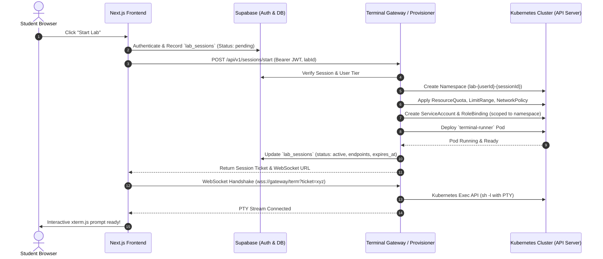
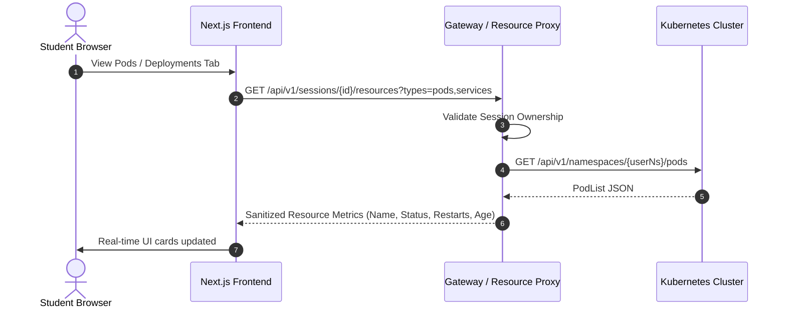
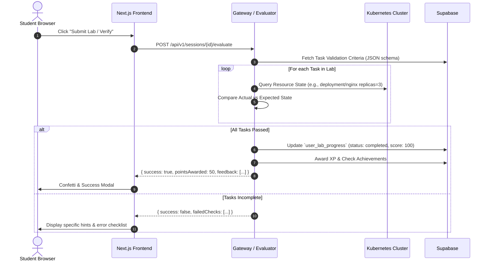

# KubeLab – Technical Architecture Document

## 1. System Overview

**KubeLab** is a multi-tenant, cloud-native interactive Kubernetes learning platform designed to provide real, isolated Kubernetes practice environments accessible directly inside a web browser.

The architecture decouples the user-facing web tier (Next.js & Supabase) from the compute-heavy, security-sensitive infrastructure tier (Terminal Gateway & Kubernetes Provisioner).

```
+-----------------------------------------------------------------------------------+
|                                 CLIENT TIER                                       |
|  +-----------------------------------------------------------------------------+  |
|  |                  Next.js Modern Web Application (Dark-First)                 |  |
|  |  +----------------+  +-----------------+  +---------------+  +-----------+  |  |
|  |  | Interactive UI |  | xterm.js WebTTY |  | Monaco Editor |  | Live K8s  |  |  |
|  |  | Dashboard/Labs |  | Terminal Client |  | (YAML Spec)   |  | Dashboard |  |  |
|  |  +----------------+  +-----------------+  +---------------+  +-----------+  |  |
+--+----------|--------------------|-------------------|----------------|-----------+--+
              |                    |                   |                |
     HTTPS / REST / Auth     Secure WebSocket        HTTPS            HTTPS
              |             (WSS + Lab Token)          |                |
              v                    |                   v                v
+-----------------------------+    |    +------------------------------------------+
|      DATA & AUTH TIER       |    |    |          INFRASTRUCTURE TIER             |
|  +-----------------------+  |    |    |  +------------------------------------+  |
|  |     Supabase PaaS     |  |    |    |  | Terminal Gateway & Lab API Proxy   |  |
|  |  * Supabase Auth      |  |    |    |  | * JWT/Session Ticket Verification  |  |
|  |  * Postgres (RLS)     |  |    |    |  | * WebSocket <-> PTY Bridge         |  |
|  |  * Storage (Assets)   |  |    |    |  | * K8s API Reverse Proxy (Filtered) |  |
|  |  * Realtime Pub/Sub   |  |    |    |  | * Automated Lab Evaluator          |  |
|  |  * Edge Functions     |  |    |    |  +-----------------|------------------+  |
|  +-----------------------+  |    |    +--------------------|---------------------+
+-----------------------------+    |                         |
                                   |                 Kube-API / In-Cluster
                                   +-------------------------|
                                                             v
                                        +------------------------------------------+
                                        |       KUBERNETES CLUSTER WORKLOADS       |
                                        |  (Kind for local dev / K3s/EKS for prod) |
                                        |                                          |
                                        |  +------------------------------------+  |
                                        |  | Namespace: lab-user-{id}-{session} |  |
                                        |  |  * Pod: terminal-runner (Alpine)   |  |
                                        |  |    - Restricted user (non-root)    |  |
                                        |  |    - kubectl, k9s, helm, curl, jq  |  |
                                        |  |    - Scoped ServiceAccount Token   |  |
                                        |  |    - ResourceQuota (CPU/RAM/PIDs)  |  |
                                        |  |    - Strict NetworkPolicy (Egress) |  |
                                        |  |  * Student Workloads:              |  |
                                        |  |    - Pods, Deployments, Services   |  |
                                        |  +------------------------------------+  |
                                        +------------------------------------------+
```

---

## 2. Component Responsibilities

### 2.1 Frontend (Next.js, TypeScript, Tailwind CSS, shadcn/ui)
- **Role**: Client application, authentication flows, UI state, user telemetry.
- **Key Modules**:
  - **Landing Page**: Modern developer hero section, features, pricing, roadmaps.
  - **User Dashboard**: Metrics, streak tracker, current enrolled labs, XP leaderboard.
  - **Lab Catalog**: 22 curated tracks from Pod basics to RBAC and Network Policies.
  - **Playground IDE**: Split-pane layout with Monaco editor (YAML), live terminal (xterm.js), dynamic resource viewer, and instruction steps.
  - **Admin Panel**: Lab content management, user metrics, active cluster sessions monitor.

### 2.2 Backend & Data Tier (Supabase)
- **Role**: Authoritative data store and identity provider.
- **Components**:
  - **Supabase Auth**: Email/password, OAuth providers, JWT issuance with custom user claims.
  - **PostgreSQL Database**: Relational schema storing user profiles, lab definitions, task validation rules, progress metrics, and audit logs.
  - **Row Level Security (RLS)**: Enforces zero-trust database access at the query engine level.
  - **Supabase Realtime**: Broadcasts lab progress updates, session countdowns, and evaluation completions.

### 2.3 Terminal Gateway & Lab API Proxy (Infrastructure Node.js / Go Service)
- **Role**: Mediates between frontend WebSockets and Kubernetes container PTYs.
- **Responsibilities**:
  - Authenticates WebSocket connection requests using short-lived session tickets signed by the application.
  - Attaches to the user's running `terminal-runner` pod using the Kubernetes Exec API (`/api/v1/namespaces/{ns}/pods/{pod}/exec`).
  - Pipes terminal input/output (ANSI escape sequences, window resize events) bidirectionally with xterm.js.
  - Enforces session idle timeouts and terminal output throttling.

### 2.4 Kubernetes Provisioner & Lifecycle Controller
- **Role**: Provisions, manages, and cleans up isolated student environments.
- **Lifecycle Sequence**:
  1. **Provision Request**: Upon lab start, creates an isolated Kubernetes namespace: `lab-session-{sessionId}`.
  2. **RBAC Configuration**: Binds a scoped `Role` and `RoleBinding` granting full permissions *only* within the student's namespace.
  3. **Resource Guardrails**: Applies a strict `ResourceQuota` (e.g. Max 4 Pods, 1 CPU core, 1Gi Memory) and `LimitRange`.
  4. **Network Policy**: Denies access to internal cluster metadata (AWS/GCP metadata endpoints, kube-dns spoofing, cross-namespace traffic).
  5. **Terminal Pod Launch**: Deploys the student's shell container configured with custom prompt (`student@kubelab:~$ `) and kubectl pre-authenticated.
  6. **Reaper Service**: Monitors `expires_at` timestamps (default: 30 minutes) and deletes expired namespaces automatically.

### 2.5 Automated Lab Evaluation Engine
- **Role**: Evaluates student accomplishments against objective criteria without trusting client input.
- **Execution Mechanism**:
  - Runs in the trusted infrastructure tier.
  - Reads lab evaluation criteria defined in Supabase (`lab_tasks.validation_config`).
  - Directly queries the Kubernetes API server for the target namespace.
  - Validates object existence, label selectors, container images, replica readiness, and service endpoints.
  - Returns structured task evaluation results (Success/Failed, checklist items, diagnostic messages) and records scores to Supabase.

---

## 3. Communication Flows

### Flow 1: Lab Session Creation & Terminal Connection


### Flow 2: Live Resource Dashboard Sync


### Flow 3: Lab Verification & Evaluation

